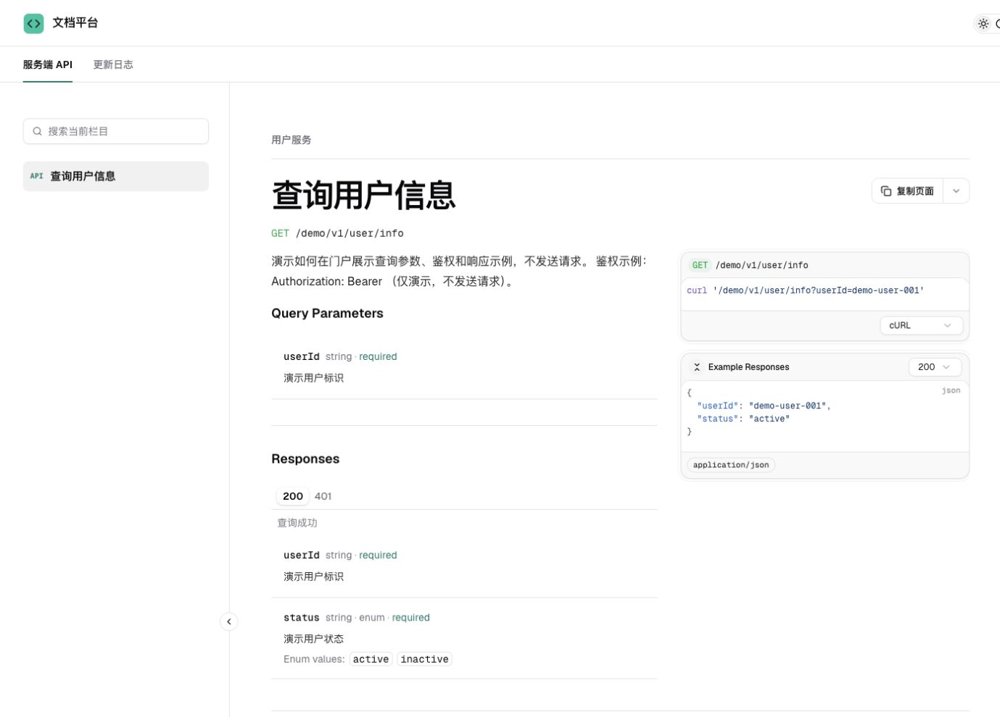
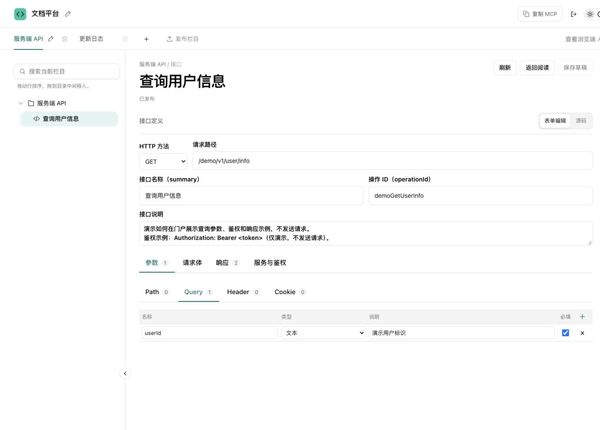
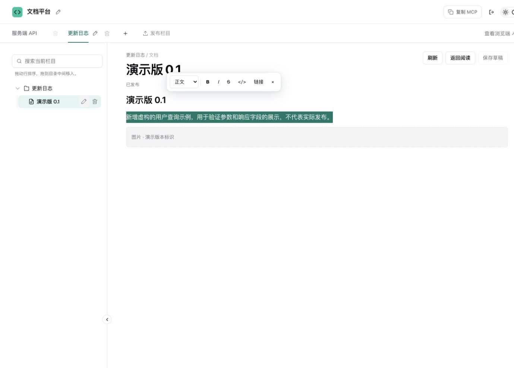

# DocSprig

[简体中文](README.md) | **English**

A customizable API documentation portal built on Zudoku, with a public reader, an admin workspace, visual Markdown and OpenAPI editing, versioned draft publishing, and separate public and admin MCP endpoints.

## Screenshots

These screenshots show the application running locally with generic demo content. The interface shown is in Chinese.

### API documentation reader

Navigate sections and documents in the sidebar, and browse API parameters, response fields, and code samples in multiple languages.



### Visual OpenAPI editor

Manage endpoints, parameters, request bodies, and responses through forms. Saving a draft and publishing are separate actions.



### Visual Markdown editor

Edit directly in the document and select text to apply formatting, without writing Markdown source by hand.



## Features

- `/doc`: a read-only public reader, with navigation and pages driven by published snapshots.
- `/admin`: an authenticated workspace for managing sections, document trees, Markdown, and OpenAPI content. Save drafts before publishing.
- PostgreSQL storage for navigation, immutable content versions, release snapshots, audit records, and site settings.
- Separate MCP endpoints: `/mcp/docs` for public read-only access and `/mcp/admin` for token-protected administration.
- Content updates do not require rebuilding the frontend. Builds only produce frontend assets.

## Quick start

Requirements: Node.js 22.22+, pnpm 10+, and PostgreSQL 14+.

```bash
pnpm install
cp .env.example .env.development.local
# Configure DATABASE_URL and the admin password
pnpm build
pnpm db:migrate
pnpm start
```

Open `http://127.0.0.1:4391/doc` to browse documentation, or `/admin` to access the admin workspace. For production, copy `.env.example` to `.env.production.local`, configure a separate database and strong passwords, run `pnpm db:migrate:prod`, and start the application with `pnpm start:prod`.

The launcher reads only the selected private environment file. It does not automatically create databases, run migrations, start Docker, or print connection strings. `DATABASE_URL` can point to a local, containerized, or remote PostgreSQL instance; you choose the database name. Set `DOCS_DATABASE` to specify the migration target database; its default is `docs_dev`.

## Development commands

```bash
pnpm dev                # Frontend development server
pnpm typecheck          # TypeScript checks
pnpm test               # Unit, HTTP, storage, and editor tests
pnpm build              # Build the portal
pnpm test:admin:browser # Admin workspace browser regression tests
pnpm test:mcp:browser   # MCP interaction regression tests
```

Isolated browser and PostgreSQL tests are run explicitly and do not connect to deployed environments. Use `pnpm demo:docker` for the Docker demo; run it only when needed.

## Content model

Each node is a `group`, `markdown`, or `api` node. The draft tree references immutable content versions. Publishing creates an immutable release snapshot and switches the current-release pointer in a single transaction. Public requests read only the current published snapshot; admin edits remain private until published.

Markdown and OpenAPI content are stored directly in the database. At runtime, the application reads and renders that content without depending on object storage or generated documentation files in the repository. The bundled `public/content/dev/current` directory provides generic demo seed content for an empty database only.

## MCP

Set `DOCS_MCP_TOKEN` to enable admin MCP access. Public MCP requires no token and can only read published content. Never commit the admin token to Git, include it in frontend assets, or mix it with public client configuration. See the [MCP integration guide](docs/infra/mcp.md) for tools and client configuration; that guide is currently in Chinese.

## Security

- `.env.*.local` files are ignored by Git. Never commit real passwords, tokens, or connection strings.
- Admin APIs require an authenticated session. Login and write operations enforce same-origin checks.
- Use HTTPS, dedicated database accounts, strong random passwords, and a strong MCP token in production.
- Demo content does not represent any real service or organization.

## License

DocSprig is licensed under the [MIT License](LICENSE). See [third-party notices](THIRD_PARTY_NOTICES.md) for dependency licenses and copyright notices.
