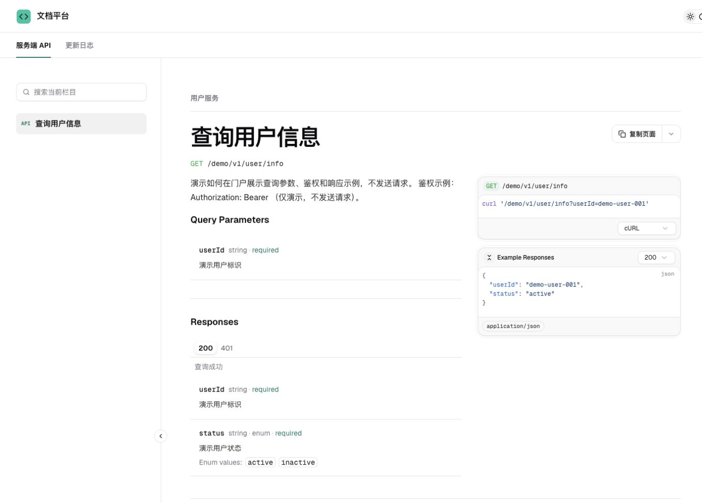
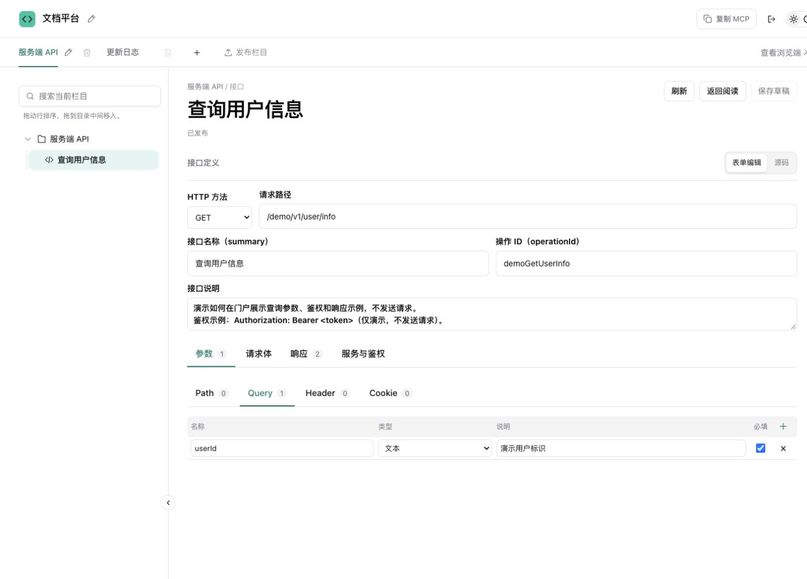
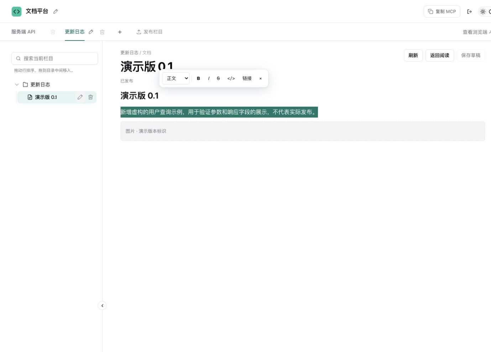

# DocSprig（文芽）

**简体中文** | [English](README.en.md)

一个基于 Zudoku 的可定制 API 文档门户，提供公开浏览端、管理员工作台、Markdown 文档、OpenAPI 接口编辑、版本化草稿发布和双 MCP 入口。

## 效果预览

以下为本地运行的真实界面，内容均为通用演示数据。

### API 文档浏览

左侧切换栏目和文档，正文展示接口参数、响应字段与多语言调用示例。



### OpenAPI 可视化编辑

管理员通过表单维护接口、参数、请求体和响应；保存草稿与发布分开操作。



### Markdown 可视化编辑

直接在正文中编辑，选中文字即可设置格式，无需手写 Markdown 源码。



## 特性

- `/doc`：只读浏览已发布内容，目录和页面由发布快照驱动。
- `/admin`：管理员登录后维护栏目、文档树、Markdown 和 OpenAPI 内容，保存草稿后再发布。
- PostgreSQL：保存目录、不可变内容版本、发布快照、审计记录和站点设置。
- MCP：`/mcp/docs` 提供公开只读能力；`/mcp/admin` 提供受令牌保护的管理能力。
- 内容更新不需要重新构建前端；构建只负责前端资源。

## 快速开始

要求：Node.js 22.22+、pnpm 10+、PostgreSQL 14+。

```bash
pnpm install
cp .env.example .env.development.local
# 编辑 DATABASE_URL 和管理员密码
pnpm build
pnpm db:migrate
pnpm start
```

打开 `http://127.0.0.1:4391/doc` 浏览文档，打开 `/admin` 进入管理工作台。生产环境请复制为 `.env.production.local`，使用独立数据库和强密码，执行 `pnpm db:migrate:prod` 后运行 `pnpm start:prod`。

启动器只读取被选中的私有环境文件，不会自动建库、迁移、启动 Docker 或打印连接串。`DATABASE_URL` 可以指向本机、容器或远程 PostgreSQL；数据库名由部署者自行决定。迁移目标可通过 `DOCS_DATABASE` 指定，默认是 `docs_dev`。

## 开发命令

```bash
pnpm dev              # 前端开发服务器
pnpm typecheck        # TypeScript 检查
pnpm test             # 单元、HTTP、存储和编辑器测试
pnpm build             # 构建门户
pnpm test:admin:browser # 管理工作台浏览器回归
pnpm test:mcp:browser   # MCP 交互回归
```

浏览器和 PostgreSQL 隔离测试是显式命令，不会连接部署环境。Docker 演示使用 `pnpm demo:docker`，只应在明确需要时运行。

## 内容模型

每个节点是 `group`、`markdown` 或 `api`。草稿树引用不可变内容版本；发布时在一个事务中生成不可变 release 快照，并切换当前发布指针。公开读取只读取当前快照，管理员编辑不会影响浏览端，直到执行发布。

Markdown 和 OpenAPI 都以数据库正文保存。应用运行时从数据库读取并渲染，不依赖 OSS 或仓库内的生成文档文件。内置的 `public/content/dev/current` 仅用于空库的通用演示种子。

## MCP

设置 `DOCS_MCP_TOKEN` 后启用管理 MCP。公开 MCP 不需要令牌，只能读取已发布内容。管理 MCP 的令牌不要提交到 Git、不要放进前端资源，也不要与公开配置混用。具体工具和客户端配置见 [MCP 接入](docs/infra/mcp.md)。

## 安全说明

- `.env.*.local` 被 Git 忽略，禁止提交真实密码、令牌或连接串。
- 管理 API、登录和写操作校验管理员会话及同源来源。
- 生产部署请使用 HTTPS、独立数据库账号、强随机密码和 MCP 令牌。
- 示例数据只用于演示，不代表任何真实服务或组织。

## 许可证

本项目使用 [MIT 许可证](LICENSE)。第三方依赖及其版权声明见 [第三方说明](THIRD_PARTY_NOTICES.md)。
